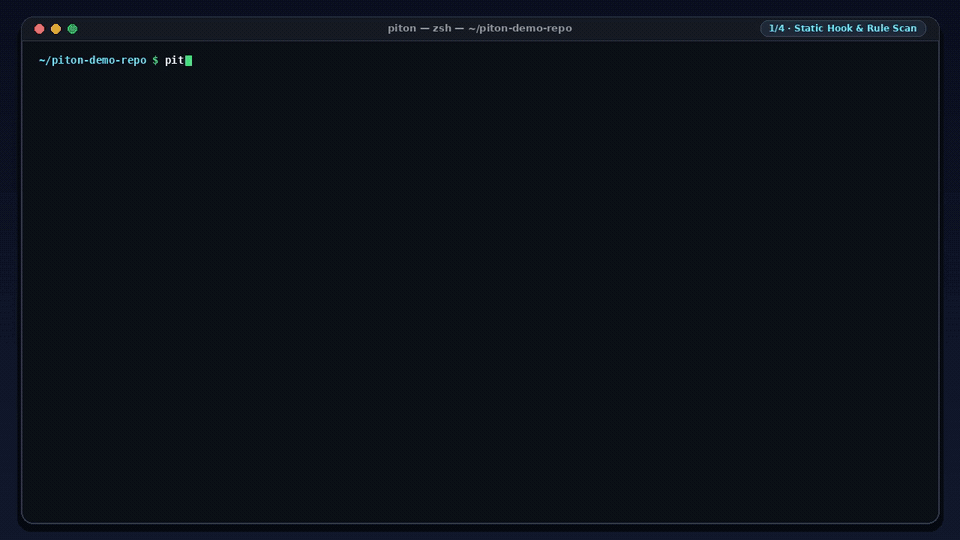

# Piton

[](https://pypi.org/project/piton-cli/)
[](https://github.com/Tony-Stark2025/piton/actions/workflows/ci.yml)
[](https://github.com/Tony-Stark2025/piton/releases)
[](https://github.com/Tony-Stark2025/piton/pkgs/container/piton-sidecar)
[](LICENSE)

**Lockfile and static supply-chain scanner for MCP servers, Claude Code hooks, and Cursor rules.**

> Don't wrap your agents in a probabilistic prompt firewall. Hammer deterministic split-hash pins into every MCP tool, Claude/Cursor hook, and schema.



Every AI coding agent (`Claude Code`, `Cursor`, `Claude Desktop`, `OpenCode`) now pulls unpinned third-party MCP tool descriptions, executes `.claude/settings.json` shell hooks, and ingests `.cursor/rules` / skill markdown files straight into privileged developer sessions. One silent upstream description edit (an MCP rug pull) or a malicious PR hook turns your repo into instant RCE.

**Piton** gives you a 30-second deterministic lockfile and PR gate—and scales all the way to shadow-to-enforce policy replay (`CEL`/`Cedar` export) and a production Go Envoy v3 `ext_proc` sidecar.

---

## 30-Second Quickstart

Slim Python CLI — **only 2 runtime dependencies (`pydantic` + `pyyaml`)**:

```bash
# Zero-install instant scan (works anywhere with uv):
uvx piton-cli scan --repo .

# Or test it right now against our intentionally poisoned demo repo (catches 8 CRITICAL/HIGH findings in <1s):
git clone https://github.com/Tony-Stark2025/piton-vuln-demo.git && uvx piton-cli scan --repo piton-vuln-demo

# Or install permanently via pipx / pip:
pipx install piton-cli   # or: pip install piton-cli

# 1. Zero-config scan: catches .claude/settings.json hook RCE, .vscode/tasks.json folderOpen autorun,
#    malicious STDIO MCP commands, and hidden-Unicode / prompt-injection poisoning in .cursor/rules & CLAUDE.md
piton scan --repo .

# 2. Pin every MCP server with split SHA-256 hashes (probing live HTTP/SSE & STDIO servers)
#    Quarantines Day-1 poisoned tools before writing piton.yaml + piton.lock
piton init --repo . --probe

# 3. Wrap any local STDIO MCP server in Cursor / Claude Code to block live rug pulls & over-bounds calls
piton wrap --enforce --server github -- npx -y @modelcontextprotocol/server-github
```

### Drop Into Any Repo in 5 Lines of GitHub Actions

```yaml
- name: Piton — AI Agent Supply-Chain & MCP Lockfile Gate
  uses: Tony-Stark2025/piton@v0.4.2
  with:
    scan-only: "true" # or `probe: "true"` / `manifest: observed_tools.json` for MCP lockfile diffs
```

Fails pull requests loudly on:
- **Third-party MCP rug pulls** (`description_sha256` drift on `third_party` servers)
- **Structural `inputSchema` drift** (`structural_sha256` drift on **all** servers—while `internal` docstring edits only warn so you never break deploys)
- **Cross-server tool shadowing** (duplicate tool names across distinct MCP servers)
- **Day-1 MCP tool poisoning** (NFKC homoglyphs, zero-width/bidi Unicode, covert tags, exfil directives)
- **Coding-agent config RCE** (`.claude/settings.json` `curl|sh` / reverse shell / credential-harvesting hooks, unsafe `Bash(*)` wildcards, `.vscode/tasks.json` `folderOpen` autorun, poisoned `.cursor/rules` & skill files)

---

## Why Split-Hash Pinning + Shadow Replay?

1. **Split-Hash Lockfiles (`structural_sha256` vs `description_sha256`)** — Naive single-hash pinning breaks CI every time an internal team fixes a typo in a docstring. Piton separates machine contract hashes (`name` + structural `inputSchema`, always hard-blocked) from prose hashes (`description` + property descriptions: hard-blocked on `third_party` MCPs, warning-only on `internal` MCPs unless poisoning lint triggers).
2. **Shadow-to-Enforce Policy Calibration (`piton replay`)** — The #1 reason teams disable agent security proxies is false blocks and hand-writing policy. Piton records **PII-preserving tokenized traces** (`alice@acme.com` → `tok_8f1a2b3c@acme.com`, keeping domains and numeric ceilings replayable without storing raw PII) OR ingests existing **OpenTelemetry (OTel) JSONL spans**, replays them offline to compute exact false-block rates, and exports calibrated policies straight to your existing gateway:

```bash
# Calibrate bounds offline against shadow traces or OTel spans until false-block rate = 0%
piton replay --config piton.yaml --traces .piton/traces.jsonl --simulate-enforce

# Export calibrated policies directly to agentgateway (CEL) or ToolHive / AWS AgentCore (Cedar)
piton replay --config piton.yaml --traces .piton/traces.jsonl --export cel
piton replay --config piton.yaml --traces .piton/traces.jsonl --export cedar
```

---

## Try the 60-Second End-to-End Local Demo

Runs live Day-1 poisoning quarantine, zero-secret `/gw` egress key swapping + chunk-boundary response secret scrubbing, shadow recording, Go↔Python HMAC ledger verification, and `replay` calibration with zero external API keys:

```bash
git clone https://github.com/Tony-Stark2025/piton.git
cd piton
python3 -m venv .venv && source .venv/bin/activate
pip install -e ".[dev]"
bash examples/quickstart-billing-agent/run_demo.sh
```

---

## Enterprise Runtime & Gateway Integration

When you move from local coding agents and CI gates into production multi-agent Kubernetes fleets, Piton includes a **hardened static Go sidecar** (`sidecar/`, prebuilt multi-arch binaries + distroless GHCR image) and a **zero-dependency Control Plane**:

```text
  [ Repo / CI ] ──► piton scan + piton init --probe ──► piton.yaml + piton.lock
                                                                │
  [ Envoy / agentgateway / Agent ] ◄──► [ Go Sidecar (Envoy v3 ext_proc gRPC + /mcp + /gw) ]
                                           • RS256/ES256 OIDC JWKS + RFC 8693 OBO (`sub`/`act`)
                                           • Live tools/list Rug-Pull Pin (`BodyMutation` -32001)
                                           • Declarative Response Projection (token & exfil reduction)
                                           • MCP 2026-07-28 MRTR `input_required` + signed approval retry
                                           • Optional Redis/Valkey shared 1h budgets across K8s replicas
                                           • Sliding-window multi-encoding secret scrubber
                                                                │
                                                                ▼
                                        [ Piton Control Plane (`piton control-plane`) ]
                                           • Slack Block Kit & Web UI MRTR Approval Bridge
                                           • Multi-Pod Signed Ledger Collector (Go↔Python HMAC)
                                           • Per-Agent Shadow→Enforce Readiness Scorecards
                                           • Tamper-Evident Signed SOC2 / EU AI Act Audit Export
```

### Kubernetes + Envoy Gateway Deployment (Helm)

```bash
helm install piton-sidecar ./deploy/helm/piton-sidecar \
  --set image.repository=ghcr.io/tony-stark2025/piton-sidecar \
  --set secrets.existingSecret=piton-sidecar-keys \
  --set redis.enabled=true \
  --set redis.addr=redis-master.default.svc.cluster.local:6379 \
  --set controlPlane.collectorUrl=http://piton-control-plane:8090 \
  --set envoyGateway.enabled=true \
  --set envoyGateway.targetRef.name=mcp-agents-route
```

### Real Envoy Proxy v1.33 Wire E2E Harness

Every commit is verified in CI against a live `envoyproxy/envoy:v1.33-latest` container wired to our distroless Go sidecar over HTTP/2 gRPC `ext_proc`:

```bash
cd deploy/envoy-e2e
docker compose up -d --build
python3 verify_envoy_e2e.py
docker compose down -v
```

### Enterprise Control Plane (MRTR Slack/Web Approval Bridge + Fleet Ledger)

```bash
# Terminal 1: Start central Governance UI, Fleet Ledger Collector & MRTR Slack/Web Approval Bridge
PITON_LEDGER_SIGNING_KEY="dev-secret-key-32-bytes-minimum" \
  piton control-plane --host 127.0.0.1 --port 8090

# Terminal 2: Run agent with zero real secrets in env, streaming telemetry & escalations to Control Plane
PITON_LEDGER_SIGNING_KEY="dev-secret-key-32-bytes-minimum" \
  piton run --collector-url http://127.0.0.1:8090 -- python my_agent.py
```

---

## CLI Reference

```bash
piton scan --repo .                                         # Scan Claude/Cursor hooks, tasks, rules & skills
piton init --repo . [--probe] [--manifest tools.json]       # Generate piton.yaml (shadow), piton.lock & .env.agent
piton lock --diff [--probe | --manifest tools.json]         # PR gate: split-hash drift + shadowing + hook RCE
piton lock --update [--probe | --manifest tools.json]       # Refresh approved lockfile hashes after review
piton wrap --server <name> -- <stdio-mcp-cmd>               # Runtime STDIO pin & bounds for Cursor / Claude Code
piton replay --simulate-enforce [--export cel|cedar]        # Calibrate bounds from ledger or OTel spans
piton run [--collector-url URL] -- <agent-cmd>              # Zero-secret local agent runner (auto-fetches sidecar)
piton top --traces .piton/traces.jsonl [--follow]      # Live PII-tokenized flight recorder
piton ledger-verify --traces .piton/traces.jsonl       # Verify Go↔Python HMAC chain integrity
piton control-plane --host 127.0.0.1 --port 8090            # Fleet ledger collector, MRTR bridge & SOC2 export UI
```

---

## Running All Tests

```bash
# Go sidecar race tests (Envoy v3 gRPC ext_proc, OIDC RS256/ES256, Redis store, Response Projection)
(cd sidecar && go test -race -v ./...)

# Python supply-chain, live MCP probe/wrap, Control Plane E2E & cross-language Go↔Python suites
pytest tests/ -v
```
